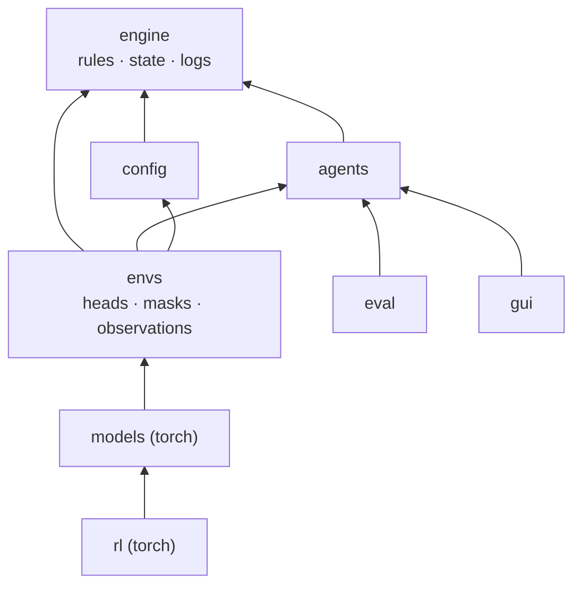
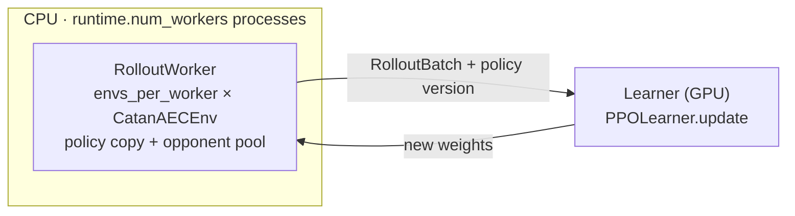
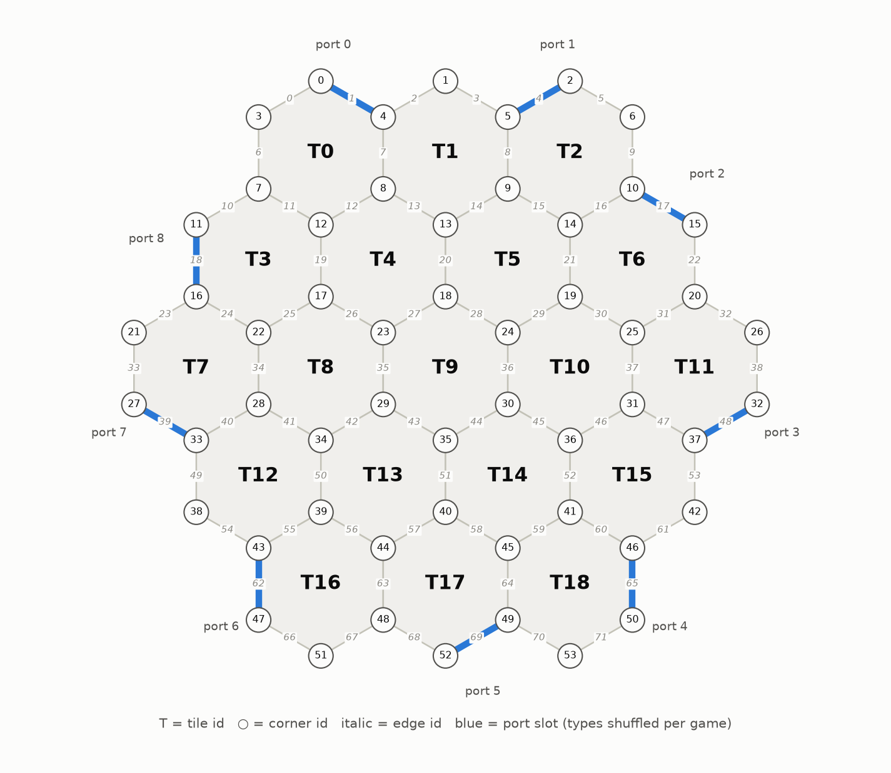
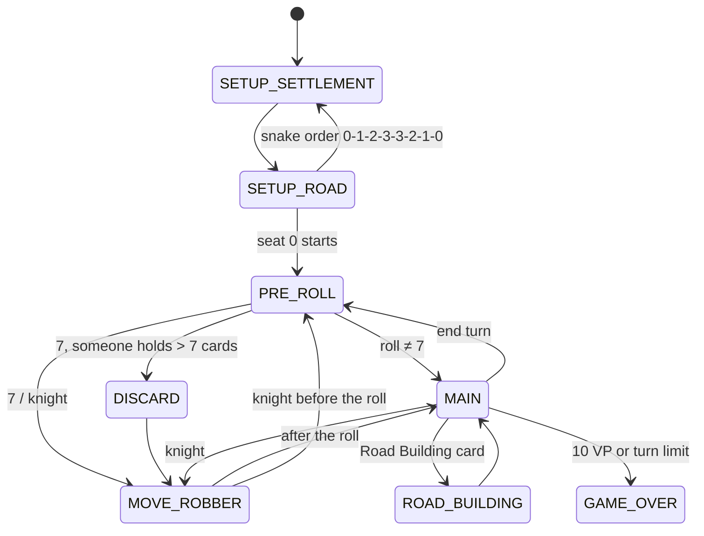

# CARLA - Catan Advanced Reinforcement Learning Agent

A powerful Deep RL catan agent. 
All code (game engine, RL, GUI, tests, etc.) was written from scratch and is intellectual property of Rafael Reis, Lucas Bessai, Suraj Vadulas and Dan Suissa.

CARLA learns full 4-player Settlers of Catan by self-play PPO on top of its own deterministic rules engine (ECSE 552 course project, McGill).

## Status

| Module | Workstream | State |
|---|---|---|
| `engine/` | engine | **Done, tested.** Full base rules: setup, production with bank shortage, discards and robber, building, maritime trade, all development cards, Longest Road with cuts, Largest Army, victory. Also legal-action enumeration, snapshot/restore, seeded replay, JSON and text logs. Domestic trade: interface only. |
| `config/` | shared | **Done.** Typed dataclasses, YAML `extends`, dotted overrides, strict validation. |
| `envs/` | RL | **Working v0.** Factored action heads and masks, observation encoder, rewards, self-play env, Gymnasium env. |
| `agents/` | eval/bots | **Working v0.** Random bot and greedy heuristic bot (wins 100% against random). |
| `eval/` | eval/bots | **Working.** Seeded tournaments with seat rotation and Wilson CIs, multi-process. Plots and trade metrics: TODO. |
| `models/` | models | Masked factored distribution and MLP baseline **done**. GNN, set attention, belief module, trade decoder: **interfaces + TODOs**. |
| `rl/` | RL | GAE, rollout collection, checkpoints, `carla train` dry run **done**. PPO update, async workers, opponent pool: **interfaces + TODOs**. |
| `gui/` | GUI | Stub (Arcade). |

## Setup

Python 3.11+. With [uv](https://docs.astral.sh/uv/) (recommended):

```bash
uv sync --extra cpu --extra dev     # laptops and the Slurm cluster (CPU-only torch)
uv sync --extra cu130 --extra dev   # RTX 50xx workstation (CUDA 13 torch, NVIDIA driver >= 580)
source .venv/bin/activate           # or prefix commands with `uv run`
pre-commit install                  # ruff + black on every commit
```

Commit the `uv.lock` created by the first `uv sync`, so everyone runs identical versions. Plain pip also works: install torch from pytorch.org, then run `pip install -e ".[dev]"`. Add the `gui` extra for Arcade.

## Commands

```bash
pytest -n auto                       # all tests; -m "not slow" skips the 200-game sweep
ruff check . && black --check .
carla simulate --games 5 --agents heuristic random random random --save runs/games
carla replay runs/games/game_0000.json.gz --step 120   # position after line #120 of game_0000.txt
carla tournament --config configs/bots.yaml            # win rates with 95% CIs
carla config configs/experiments/gnn.yaml model.belief=gru   # print a resolved config
carla train configs/smoke.yaml       # dry run until the PPO update lands
python scripts/benchmark_engine.py
sbatch --array=0-2 scripts/slurm/train.sbatch configs/experiments/mlp.yaml   # 3 seeds
```

## Layout

```
configs/          base.yaml, experiments/ (one ablation = one field), smoke.yaml, bots.yaml
docs/img/         figures
scripts/          benchmark_engine.py, render_board.py, slurm/train.sbatch
src/carla/
  engine/         rules engine, stdlib only                    [engine]
  config/         experiment config schema + loader            [shared]
  envs/           action heads/masks, observations, envs       [RL]
  rl/             PPO, rollouts, opponent pool, training       [RL]
  models/         torch networks                               [models]
  agents/         Agent interface, bots, registry              [eval/bots]
  eval/           game runner, tournaments, statistics         [eval/bots]
  gui/            Arcade viewer and human play                 [GUI]
  utils/          seeding, run directories
  cli.py          the `carla` command
tests/            mirrors src/carla
```

## Architecture

An arrow means "imports". Nothing imports upwards: `engine` imports no other `carla` package, and torch appears only in `models` and `rl`. This lets each workstream build and test on its own.



Three contracts connect the workstreams:

1. **Observations**: `envs/observation.py` lists the arrays. Seats are relative (0 = the actor), and there are no board coordinates.
2. **Action masks**: `envs/action_space.py` documents the heads and the mask table.
3. **Policy output**: `models/base.py` defines `PolicyOutput`, and `FactoredDistribution` samples it, scores log-probs and computes the exact entropy.

Planned training loop (semi-asynchronous PPO, `rl/`):



## Engine

```python
from carla.engine import Game, GameRecord

game = Game(seed=42)                       # board and dice both follow from the seed
while not game.is_over:
    game.step(game.legal_actions()[0])     # legal_actions() is what the masks encode
snap = game.snapshot()                     # cheap full copy; game.restore(snap) for search
record = GameRecord.from_game(game)        # every decision + its chance outcome
record.save("game.json.gz"); record.save_text("game.txt")
position = GameRecord.load("game.json.gz").replay(120)   # load into any position
```





- **Actions** are `Action` named tuples whose fields are the policy heads (type, corner, edge, tile, player, dev, resource, resource2, trade). Every enumerable action is a pre-built singleton with an index in `ACTION_INDEX`.
- **Hidden information.** The engine treats other seats' hands and development cards as hidden. `Event.visible_to(seat)` redacts the event stream, and a test checks that the observation encoder leaks neither.
- **Determinism.** Board and dice use separate RNG streams derived from the seed. Logs store each chance outcome (dice, card drawn, card stolen) and a per-step state hash, so a replay is exact and any divergence is reported.
- **Rule choices.** Discards are made one card at a time, in turn order from the roller. The robber's victim is chosen with the move. Boards keep 6s and 8s apart. Victory is checked for the player whose turn it is, so points gained on someone else's turn win at the start of your own. `engine.max_turns` truncates stalled games.
- **Speed** (one core of a cloud container): ~50 random games/s (~64k decisions/s), ~95 heuristic games/s, ~3.8k learner steps/s through `CatanEnv`. Throughput scales with processes. Cython is not needed so far; profile `rules.legal_actions` and `ObservationEncoder.encode` first.

## Conventions

- **Reproducibility.** Every run is one config file plus dotted overrides. `carla train` saves the resolved config and the git commit in its run directory. Derive every seed with `derive_seed(config.seed, ...)`.
- **Seats.** The engine uses absolute seats 0-3. Envs and models use seats relative to the actor.
- **Tests.** Every rule change comes with a test. `tests/engine/scenario.py` builds hand-made positions and checks every invariant.
- **Docs.** This README is the only documentation file; docstrings stay short.

## Design decisions

- **Own engine.** We need full control over state, snapshot/restore for search, and exact replays.
- **Hand-rolled message passing instead of PyG/DGL.** The board graph is the same in every game, so a batch shares fixed index tensors (`models/graph.py`). This avoids extension wheels on the cluster and on CUDA 13.
- **uv instead of poetry or plain venv.** It is fast, has a lockfile, and selects CPU vs CUDA torch through extras. Standard `pyproject.toml` keeps pip working.
- **Own self-play env instead of PettingZoo.** `CatanAECEnv` follows the agent-environment-cycle pattern, and `CatanEnv` is the Gymnasium single-learner wrapper. The conditional masks do not fit PettingZoo's flat `action_mask`, and workers must choose the policy for each seat. An adapter can be added later.

## Contribute

Starting Jan 2027, contributions are welcome - If you want to contribute to the project, fork the repository and submit a PR.

## References

Our learning was shaped and influenced by the brilliant contributions to the field of DRL, and Catan AIs:
- [Settlers RL](https://settlers-rl.github.io/)
- 
- 
