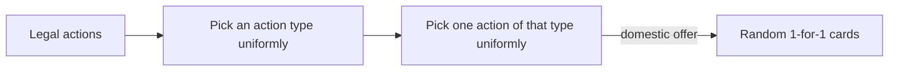
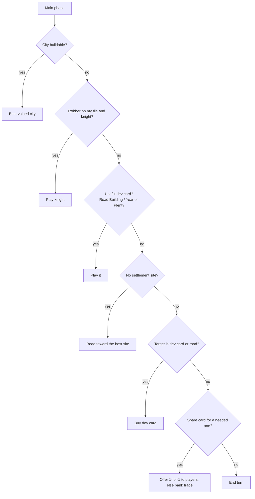
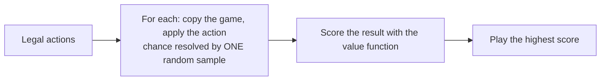
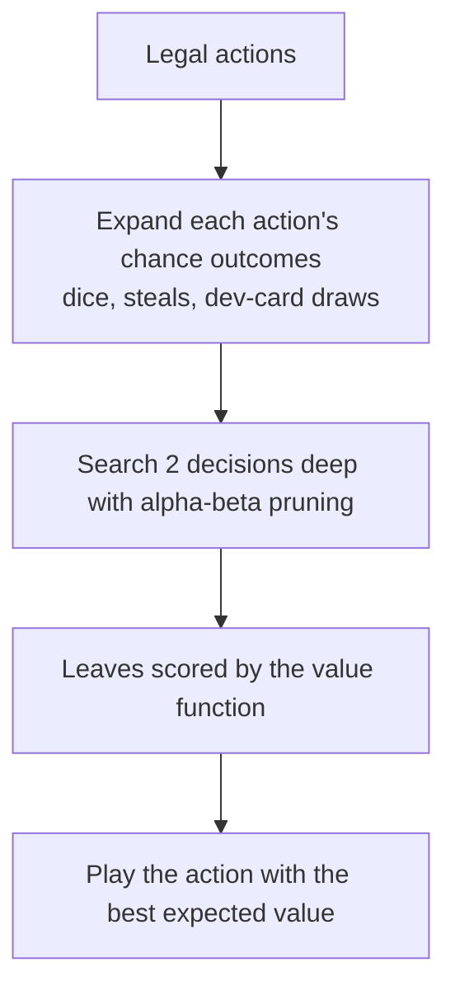
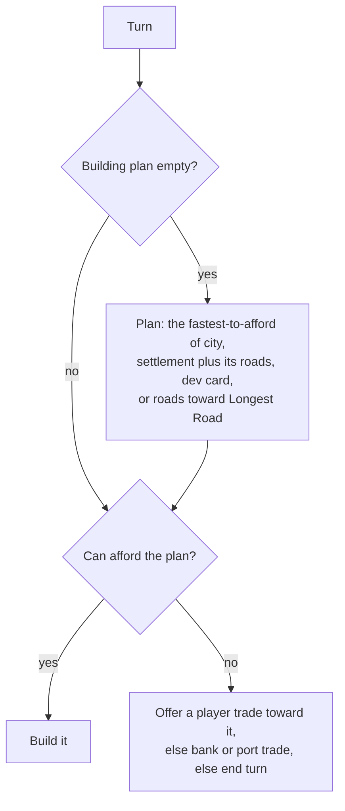
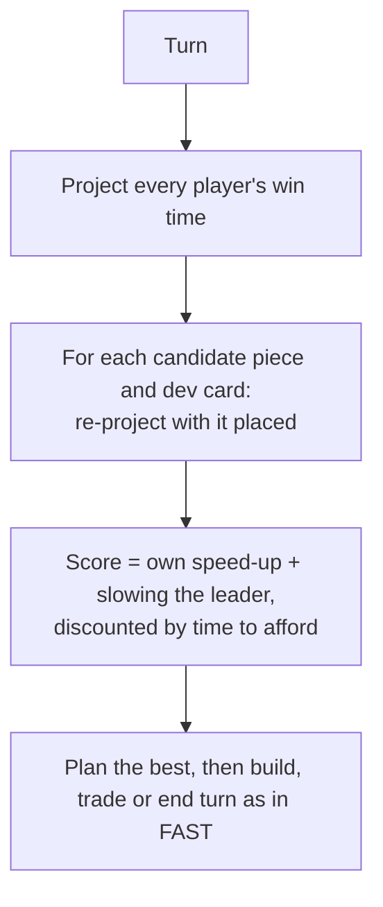

# How the agents play

A short guide to each bot's decision loop. Registry names are in brackets; benchmark setup is
in [benchmarks/README.md](benchmarks/README.md).

## Random (`random`)

The weakest baseline. Uniform over action *types* first, so rare moves (trades, dev cards)
are not drowned out by the many build locations.

## CARLA heuristic (`heuristic`)

Greedy rules with no lookahead. Sites are scored by `corner_value`: pips weighted by resource,
plus resource diversity, plus a port bonus. The current **target** is the first goal it has a
place for, in the order city, settlement, road, dev card.

Other phases: setup places the best-valued corner and a road toward the best site; the robber
goes where it hurts high-VP opponents most, never on its own tiles; it discards the resource
it holds most; it accepts an offer only if the offer reduces its shortfall for the target.

## Catanatron ValueFunction (`native-f-upstream`, original `catanatron-f`)

One-ply greedy search with a hand-tuned value function: VP, production (own minus the next
player's), reachable production, buildable nodes, hand synergy, dev cards, army size.

The single sample is the upstream behaviour. The plain `native-f` averages over all chance
outcomes instead.

## Catanatron AlphaBeta (`native-ab2-upstream`, original `catanatron-ab2`)

The same value function at the leaves of a depth-2 search: our move, then the next decision.
That decision is maximised if it is ours and minimised if it is an opponent's.

Never offers domestic trades and rejects all offers.

## JSettlers FAST (`jsettlers-fast-native`, original `jsettlers-fast-adapted`)

Plans around **building speed**: how many rolls until it can afford each piece, given its
production and ports.

## JSettlers SMART (`jsettlers-smart-native`, original `jsettlers-smart-adapted`)

FAST's machinery plus **win-time projection**: for every player, an estimate of how many rolls
they need to win. Each candidate piece is scored by how much it speeds up its own win and slows
the leader.

Shared by FAST and SMART:
- **Opening:** pick settlement pairs by number and port scores, point the road at the next site.
- **Robber:** target the player projected to win soonest, on the hex whose loss slows their
  building most.
- **Negotiation:** offer trades toward the plan; accept only if it shortens their own build
  time, the partner is not close to winning, and the partner is not racing them for the same
  spot.
