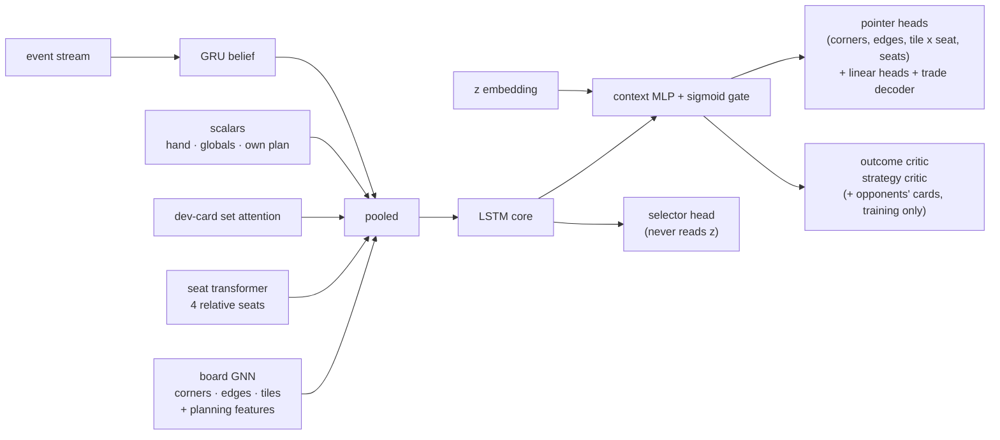

# AlphaCat: strategy-conditioned league training

AlphaCat is a training paradigm for CARLA modelled on AlphaStar (Vinyals et al., *Grandmaster
level in StarCraft II using multi-agent reinforcement learning*, Nature 2019, with its
supplementary pseudocode and `detailed-architecture.txt`). It is meant to produce a policy that
plays coherent long-term strategies and holds up against varied opponents. It adds six pieces,
each switchable in the config:

| AlphaStar | AlphaCat | Config |
| --- | --- | --- |
| entity / spatial / scalar encoders, deep LSTM core | board GNN, seat transformer, scalar MLP, GRU belief, LSTM core | `model.encoder: strategy`, `model.core: lstm` |
| auto-regressive heads, pointer networks | pointer heads over corners, edges, tiles and seats | built into `encoder: strategy` |
| supervised learning on human replays | behaviour cloning of three styled heuristic teachers | `carla strategy-bc` |
| strategy statistic z (build order + cumulative statistics) | z = first 10 purchases + 7 build counts | `strategy.*`, `model.strategy_conditioning` |
| z pseudo-rewards (edit / Hamming distance), separate critics | strategy pseudo-reward with its own critic | `strategy.pseudo_reward_*` |
| (z sampled from replays) | plus a selector head that picks a z and reconsiders it | `model.strategy_selector`, `strategy.selection` |
| V-trace + TD(λ) + UPGO, KL to the supervised policy | PPO + GAE + UPGO, KL to the strategy clone over all heads | `ppo.upgo_coef`, `ppo.reference_kl_*` |
| opponent observations in the baselines | privileged critic reading the opponents' cards | `model.privileged_value` |
| league: main agents, main exploiters, league exploiters, PFSP | the same roles over four-player tables | `carla league`, `league.*` |

What follows is the design, how to run it, the configs, checkpoint compatibility, the
diagnostics, the experiments needed to judge it, and its limits.

## 1. Representation and memory

`carla.models.strategy_net.StrategyNet` encodes each decision like this:



- **Planning features** (`env.strategic_features`, `carla.envs.strategy_features`) put future
  purchases, reservation and opportunities into the observation:
  - per corner: dice probability by resource, whether it is a free site, settleable now, or one road away;
  - per edge: buildable now, or leads to a free site;
  - per seat: expected income by resource, public build statistics, port access, points still missing;
  - for the observer: for each purchase, whether it is affordable, the cards missing and the rounds of production until they arrive; plus its previous action type.

  These features read only public information and the observer's own cards; a test changes
  the other seats' hands and checks that the features do not move.
- **Spatial and opponent-specific information reaches the action.** Settlement, city and road
  heads are pointers over the GNN's corner and edge embeddings. The robber head scores
  (tile, victim) pairs from tile embeddings and per-seat transformer embeddings. The
  trade-partner head points at seat embeddings. None of these go through a pooled vector first.
- **Recurrent state.** The belief GRU state and the LSTM (h, c) form one flat state
  `[belief | h_1..h_L | c_1..c_L]`, stored in the observation before every decision
  (`belief_state`).
- **Sequence training.** `ppo.bptt: sequence` replaces the one-decision recomputation of the
  older models. PPO samples chunks of `ppo.sequence_length` consecutive decisions of one
  environment, unrolls the network from the stored state at the chunk's first decision, and
  resets to zeros where an episode ended inside the chunk. Chunks never cross environments or
  rollouts. The encoders run once over all rows of a chunk; only the GRU and the LSTM loop over
  time (`PolicyNetwork.unroll`). Behaviour cloning trains on the same chunks, with states
  recomputed under the current weights at every epoch.
- **What tests check.** The learner reproduces the rollout's log-probabilities exactly on every
  stored decision, including selections and resets inside chunks (`test_sequence_ppo_...`), and
  `unroll` matches step-by-step `forward`.

## 2. Teachers: styled heuristic bots

`carla.agents.strategic` adds `heuristic_city`, `heuristic_expansion` and `heuristic_devcard`.
They share one planner:

- **Goal.** Each style values the goals (city, settlement, road toward a site, development card)
  differently. Each value is divided by `1 + rounds until affordable`, so a goal that would take
  too long gives way to a cheaper one.
- **Coherence.** The current goal is kept unless another scores 1.5 times higher.
- **Reservation.** The goal's cards are not spent, traded or discarded. A purchase that the
  style ranks lower than the goal is allowed only if it leaves those cards untouched.
- **Fallbacks.** Trades give only surplus. The robber targets the leader, and the bot refuses to
  trade with a player two points from winning.
- **Style-specific card play.** Monopoly uses a public estimate of the opponents' holdings;
  knights are played when the robber blocks the bot, and eagerly by the development-card style.
- Placement, ports and knight eagerness also follow the style. All decisions are deterministic.

Measured with `carla profile heuristic_city heuristic_expansion heuristic_devcard heuristic
--games 50` (200 games each, seats rotated, no domestic trade):

| agent | win rate | VP | settlements | cities | roads | dev cards | knights | longest road | largest army |
| --- | --- | --- | --- | --- | --- | --- | --- | --- | --- |
| heuristic_city | 0.255 | 7.45 | 1.85 | **2.83** | 4.23 | 3.10 | 1.21 | 0.05 | 0.05 |
| heuristic_expansion | 0.280 | 7.76 | **3.05** | 0.67 | **8.05** | 2.07 | 0.82 | **0.79** | 0.03 |
| heuristic_devcard | 0.295 | 7.64 | 1.09 | 0.82 | 3.15 | **9.55** | **5.15** | 0.04 | **0.85** |
| heuristic (baseline) | 0.170 | 7.08 | 2.04 | 2.84 | 4.45 | 0.38 | 0.18 | 0.08 | 0.01 |

The three styles are clearly distinct, and each matches or beats the baseline bot in that mixed
table. Against three baseline bots (200 games each, 25% = parity) the city style won 31% and
the expansion style 38%. The development-card style won 11% before its goal values were
retuned; the 29.5% above is after retuning, and that setting has not been re-run against three
baseline bots. The teachers are registered agents, so tournaments, the GUI, `opponents.pool`
and the league can all use them.

## 3. Strategy statistic z, conditioning and objectives

**z** (`carla.envs.strategy`, 49 numbers) has five parts:
- the first 10 purchases after setup, each a road, settlement, city or development card (10 × 4 one-hot);
- normalized counts of settlements, cities and roads built, cards bought and knights played;
- whether the seat holds longest road and largest army at the end;
- a present flag;
- a flag saying whether the episode pays the strategy pseudo-reward.

Every part is public, so the same statistics can be computed for any seat.

**Teaching z's meaning (`carla strategy-bc`).**
- **Games.** In each demonstration game one teacher plays the learner seat against a table drawn
  from all teachers and the baseline bot. Its *hindsight* z (what it actually did, as AlphaStar
  extracts z from each replay) labels all of its decisions. A game is trained without z with
  probability `strategy.sl_zero_prob` (AlphaStar: 10%).
- **Losses.** All heads' log-likelihood, offer tokens included, the outcome critic, the belief
  auxiliary loss, and the selector toward the teacher's archetype at selection points of games
  the teacher won.
- **Outputs.** `bc.pt` stores the z library (hindsight z's per archetype) next to the weights;
  `strategy_library.npz` is a copy. `conditioning.json` records how each archetype's z moves
  the purchase probabilities on held states, and `strategy_profile.csv` the clone's games under
  each variant.

**Which components see z.** z is embedded after the core. It conditions:
- every action head, through the context MLP and a sigmoid gate (AlphaStar's GLU gated by `scalar_context`);
- the trade decoder, whose context is the gated context;
- both critics.

**Playing without a prescribed strategy.** z is all zeros (`none`): 10% of training episodes
(`strategy.none_prob`), z-dropout in imitation, and an explicit variant everywhere else.

**Objectives.** Each keeps its own coefficient, and the journals log each separately:

| Signal | What it is | Where |
| --- | --- | --- |
| outcome reward | +1 win, −1 loss, 0 truncation (`env.*_reward`) | env, outcome critic |
| potential-based shaping | F = γΦ(s′) − Φ(s) between learner decisions (`env.shaping`, production by default); leaves the optimal policy unchanged | env, added to the outcome stream |
| strategy pseudo-reward | decay(turn) × −ΔD(stats, z): the drop in distance to z (normalized edit distance of the build-order prefix + mean L1 of the counts), minus `switch_cost` on a selector switch. Paid in `pseudo_reward_prob` of the episodes that have a z (AlphaStar: 25% per pseudo-reward). Halves at each `decay_turns` entry and stops after the last. **Deliberately changes the optimum toward z.** | `info["strategy_reward"]`, own GAE and critic, advantage weight `strategy.pseudo_reward_coef` |
| imitation regularization | KL(clone ‖ policy) over the action type (`reference_kl_heads: type`) or every head the taken action uses (`all`, AlphaStar's distillation). The clone sees the same z | `ppo.reference_kl_coef` |
| UPGO | clipped surrogate with the upgoing return G^U − V on the outcome stream | `ppo.upgo_coef` |
| entropy | heads and offer tokens; selector entropy on selection decisions only | `ppo.entropy_coef`, `ppo.trade_entropy_coef`, `strategy.selector_entropy_coef` |
| belief auxiliary | Poisson NLL of the opponents' hidden cards (training only) | `model.belief_loss_coef` |
| matchmaking objective | PFSP weights f(P[learner beats opponent]): **not a loss**, only which games are played | `league.pfsp_*` |

## 4. Strategy selection

- **Learned selection.** With `model.strategy_selector`, a selector head picks one of the K
  archetypes or "none" from the LSTM output and scalars. It never reads z, so choosing a
  strategy and acting under it are separate decisions.
- **When it runs.** At the seat's first decision (setup included) and at its roll every
  `strategy.reconsider_turns` own turns.
- **What a choice does.** A choice samples a concrete z of that archetype from the library and
  restarts the pseudo-reward's distance baseline: the switch itself pays nothing, but
  `switch_cost` is charged when the archetype changes. This keeps play coherent between
  reconsiderations while still allowing adaptation.
- **Acting on the same decision** (`carla.rl.acting.decide`). Rows at a selection point sample
  the archetype, switch to its z, and run again from the same input state. The action heads
  therefore always act under the strategy just chosen.
- **Training.** The selection's log-probability is stored in the observation and added to the
  action's log-probability, so the same clipped surrogate trains both. Only the advantage
  trains the selector; it gets no pseudo-reward for choosing an easy z.
- **Modes.** `strategy.selection` takes `prescribed` (sample an archetype from the library, as
  AlphaStar does), `learned`, `mixed` (prescribed with `prescribed_prob`, else learned) or
  `none`. At play time, `ppo:<path>@select | @none | @city | @expansion | @devcard` picks the
  mode.

## 5. League (`carla league`)

`carla.rl.league` adapts AlphaStar's pseudocode to four players on one machine.

- **Players.** `league.main_agents` main agents, `main_exploiters` main exploiters and
  `league_exploiters` league exploiters, all starting from `league.init_checkpoint`. Frozen
  historical copies of them join over time. Protected members are the teachers (`league.teachers`)
  and the fixed checkpoints in `league.seed_checkpoints` (by default the earlier full-model
  policy). Like AlphaStar, the league starts with a frozen copy of each main agent.
- **Strategy variants.** A strategy-conditioned policy appears in the payoff once per variant
  (`league.variants`). The matchmaker chooses the variant along with the player, so conditioned
  variants are scheduled and tracked apart. Each exploiter generation plays a fixed archetype
  (`league.exploiter_strategy`), which diversifies the exploiters; its frozen copies keep that
  archetype.
- **Four-player payoff.** Each game gives one pairwise result between the learner and each
  opponent seat. The learner wins the comparison if it finished ahead (the winner is ahead of
  everyone, the others rank by victory points), draws on equal points. P[A beats B] is 0.5 for
  equals, as in a two-player game, so AlphaStar's thresholds (0.3, 0.7) keep their meaning.
  Counts decay by 0.99 per game. Table win rates (the learner won the game; 0.25 for equals)
  are tracked separately for the exploiters' own-success test.
- **Complete tables and seat variation.** The matchmaker draws all three opponent seats of a
  table. The env randomizes the learner's seat and the opponent order is permuted, so tables
  are full compositions, never a single opponent.
- **Main agents.** 35% self-play: three seats of the current main agent in random variants. If
  the pairwise rate drops below 0.3, PFSP(f_var) over that agent's history is the curriculum.
  50% PFSP(f_hard = (1 − x)²) over every frozen player and variant. 15% verification: frozen
  exploiters it scores below 0.3 against, else forgotten main copies, found with AlphaStar's
  monotonic-suffix test; with neither, self-play.
- **Main exploiters.** Tables of three current main agents. If the exploiter's pairwise rate is
  at most 0.2, half the time it plays PFSP(f_var) over the main agent's history instead.
- **League exploiters.** PFSP(linear capped) over all frozen players.
- **Snapshots and resets.** Step counts are learner decisions; AlphaStar's numbers are scaled
  down to this budget (see `LeagueConfig`).
  - A main agent snapshots after `main_snapshot_steps` if it beats every frozen player above
    0.7, and in any case after `main_snapshot_max_steps`. Main agents never reset.
  - A main exploiter is frozen when it beats the main agents above 0.7 *and* wins at least
    `exploiter_min_win_rate` of its own games, or after the maximum steps. It then resets to the
    clone with a new archetype.
  - A league exploiter is frozen when it beats every frozen player above 0.7 or after the
    maximum steps, then resets with probability 0.25.
  - A reset clears the learner's payoff rows and restarts its environments.
- **Keeping useful history.** Past `max_historical` unprotected players, the least useful are
  pruned. Usefulness is the hardness for the learners (1 − best pairwise rate) plus how
  distinct the player's build behaviour is from the other frozen players (minimum L1 distance).
  The newest copy of each learner is always kept. Episodes in flight keep their opponents until
  they end.
- **Exploiter objectives** (`league.exploiter_objective`). In four-player games, making the main
  agent lose is not the same as winning: a third player can win instead.
  - `win` (default) rewards only the exploiter's own outcome.
  - `win_and_rank` adds `rank_bonus` per main seat it finished ahead of.
  - `main_loses` pays +1 whenever no main agent wins (kingmaking allowed; for comparison only).

  Freezing a main exploiter requires its own wins as well, so a pure spoiler is not kept as a
  counter-strategy.
- **Schedule.** One coordinator process holds every learner (policy, PPO learner, optimizer)
  and the league state. Learners take turns of `updates_per_turn` updates, in proportion to
  `league.schedule`. Rollout processes keep separate environments per learner, so episodes in
  flight stay with their learner across turns.

## 6. Information boundaries

- **Policies see their own observation.** Opponent seats run on their own observation and
  recurrent state (`ExternalAgent.state`) with their own z, and bots follow the `Agent` contract.
- **Training-only signals never reach the logits.** The opponents' hidden cards reach only the
  belief loss targets and the privileged critic. A test checks that changing those cards leaves
  every logit and the selector unchanged but moves the value.
- **z and its statistics are public.** z statistics come from public events, so opponents'
  statistics are fair planning features. The selector never reads z; a test checks this.
- **Evaluation uses no hidden information.** The value heads are unused at play time.
  `PolicyAgent` rebuilds every seat's public statistics from its replay of the public game.

## 7. Usage

```bash
# Teachers
carla profile heuristic_city heuristic_expansion heuristic_devcard heuristic --games 50
carla tournament --agents heuristic_city heuristic heuristic heuristic --games 100 --seeds 0 1

# Strategy behaviour cloning (2000 games x 16 epochs: about 40 minutes on the RTX 2070 laptop)
carla strategy-bc configs/experiments/alphacat.yaml --output runs/alphacat/bc --games 2000 --epochs 16 --workers 11

# Single-agent PPO with strategies against fixed bots (no league)
carla train configs/experiments/alphacat.yaml --init-from runs/alphacat/bc/bc.pt

# League, resume, report
carla league configs/experiments/alphacat_league.yaml
carla league configs/experiments/alphacat_league.yaml --resume runs/alphacat/league/<run>
carla league-report runs/alphacat/league/<run>

# Evaluation: robustness matrix (worst-case table), variants, strategy modes
carla robustness ppo-sampled:runs/alphacat/league/<run>/learners/main_0.pt@select --boards 25 --workers 11 --config configs/experiments/alphacat.yaml
carla evaluate runs/alphacat/league/<run>/learners/main_0.pt --opponent heuristic_city,heuristic_expansion,heuristic_devcard --strategy none --sampled
carla profile ppo-sampled:runs/.../main_0.pt@devcard heuristic heuristic_city heuristic_expansion --config configs/experiments/alphacat.yaml

# Everything, unattended and resumable (rerun the same command to continue after a crash)
python scripts/alphacat_pipeline.py
```

`ppo:<path>` plays greedily and `ppo-sampled:<path>` samples. Policies initialized by imitation
play much better sampled: the 800-game pilot clone won 12/12 sampled games against random bots
but 6/12 greedy, so the AlphaCat configs validate with `eval.deterministic: false`.

## 8. Configs

`configs/experiments/alphacat*.yaml`: each ablation changes one component.

| Config | Change |
| --- | --- |
| `alphacat.yaml` | the full model, fixed bot opponents (`carla train`) |
| `alphacat_league.yaml` | the league (main, main exploiter, league exploiter, teachers, earlier checkpoint) |
| `alphacat_no_core.yaml` | no LSTM core (one-decision BPTT) |
| `alphacat_no_strategy.yaml` | no z, selector or pseudo-reward (multi-teacher clone without z) |
| `alphacat_prescribed.yaml` | prescribed strategies only (no learned selection in training) |
| `alphacat_no_pseudo_reward.yaml` | z conditioning without the pseudo-reward |
| `alphacat_no_upgo.yaml` | no UPGO |
| `alphacat_league_no_exploiters.yaml` | the league without exploiters |
| `alphacat_league_rank_exploiters.yaml` | exploiters also rewarded for finishing ahead of the main agent |
| `configs/alphacat_smoke.yaml` | a tiny end-to-end check of BC, training and league |

The engine rules match the full-model runs (domestic trade with limits 3/3/4, 500 turns), so
the earlier checkpoints can be league members and comparison baselines.

## 9. Checkpoint compatibility

- **Old checkpoints load and play unchanged.** Every new option defaults to off. Saved configs
  lacking the new fields load with defaults, so `--resume` and `--init-from` of MLP/GNN runs
  behave as before. `ppo.bptt` defaults to `step`, so resumed belief models keep their
  one-decision BPTT. New journal columns are appended, and older CSVs gain them on resume.
- **Strategy checkpoints are new.** Strategy-network checkpoints (`encoder: strategy`) are a new
  architecture: `--init-from` needs an exactly matching model config, so an old GNN checkpoint
  cannot initialize one. Strategy checkpoints store the z library (`strategy_library`) so
  `@archetype` variants work anywhere.
- **Old checkpoints in the league.** They play as protected `seed_checkpoints` and in
  tournaments next to new ones (`carla robustness`, `ppo:` agents in every table). The
  `outputs/` full-model checkpoint (`step_000007003136.pt`, about 24% against three heuristic
  bots) is the default league member and comparison baseline.
- **Older features still work.** `policy-tournament` still supports only feed-forward
  checkpoints; use `carla robustness` for recurrent and strategy models.

## 10. Diagnostics

| Where | What |
| --- | --- |
| `episodes.csv` (train and league) | per learner episode: strategy variant, selector choices, switches, final distance to z (`strategy_adherence`), summed pseudo-reward, and build statistics (`stat_*`) |
| `updates.csv` | strategy critic loss, strategy return and advantage scale, selector entropy, selections, UPGO loss, reference KL; in a league also learner, role, generation, matchmaking branches and a strength summary (mean logit of the pairwise rates over frozen players) |
| `events.csv`, `roster.json`, `payoff.csv` (league) | snapshots, resets and prunes; roster, table win rates and per-player behaviour; the decayed pairwise payoff per (learner, opponent variant) |
| `carla league-report` | learners, events, validation curve, behaviour by variant, selector choice frequencies, hardest opponents, behaviour of frozen players |
| `strategy-bc` outputs | per-teacher win rates, `conditioning.json` (z → purchase probabilities on the same states, pairwise KL), `strategy_profile.csv` |
| `carla robustness` | per table: win rate with Wilson interval, VP and build statistics; mean and worst-table win rate |
| `carla profile` | per agent: win rate, VP, mean build statistics, opening purchase mix |

## 11. Experiments to judge improvement

No performance claim is made until these runs are done. All use held-out seeds (validation
`eval.seed` 10000, robustness 30000), seat rotation, Wilson intervals, at least 25 boards per
table, and sampled play.

1. **Base result.** Compare the main agent's robustness matrix against the earlier full-model
   checkpoint and the clone on the same tables: three heuristic bots, three of each teacher,
   the mixed teacher table, and a table seating the earlier checkpoint. Report the mean and the
   worst-table win rate; 0.25 is parity.
2. **Component ablations** with equal decision budgets: `alphacat_no_core`, `_no_strategy`,
   `_prescribed`, `_no_pseudo_reward`, `_no_upgo` under `carla train`, plus
   `alphacat_league_no_exploiters` against `alphacat_league`. Use at least 3 seeds for differences smaller than about 5 points.
3. **Strategy control.** Under `@city`, `@expansion` and `@devcard`, do the main agent's build
   statistics move toward the archetype (`carla profile`; `strategy_adherence` in `episodes.csv`)?
   How much does each z cost in win rate compared with `@select` and `@none`?
4. **Selection.** How often does each archetype get chosen, how often does the selector switch,
   and does `@select` beat the best fixed archetype?
5. **Exploitability.** Compare the exploiters' pairwise and table win rates against the main
   agent over time. A falling final-generation exploiter rate against newer main agents
   indicates robustness gains.
6. **Forgetting.** Track the main agent's win rates against its own early copies and the
   teachers (`payoff.csv`) along the run.

## 12. Pilot runs (validation only, not evidence of improvement)

- **Behaviour cloning, 800 games × 8 epochs** (base config, RTX 2070 laptop, about 9 minutes):
  action-type accuracy reached 0.837, with the loss still falling. Played greedily, the clone
  beat random bots in 6 of 12 games; sampled, in 12 of 12. Sampled against three heuristic bots
  it won 0 of 12 games with 5.5 VP on average.
- **Conditioning in that clone was weak.** On held states, the devcard z raised P(buy card)
  from 0.099 (no z) to 0.127, the expansion z raised P(road) from 0.036 to 0.045, and the mean
  pairwise KL between archetype z's was 0.014. The style is largely visible from the state
  itself (placement, income), so imitation leaves z a small role. The pseudo-reward is the
  mechanism meant to make RL follow z; whether it does is experiment 3.
- **League pilot** (150k decisions, the clone as init): about 170 learner decisions per second
  overall, with 11 rollout processes and the GPU learner. One 11,264-decision update took about
  52 s of collection and 14 s of update, using 4 GB of GPU memory. Snapshots, exploiter resets,
  payoff and journals behaved as designed.

## 13. Assumptions and limitations

- **Compute.** The roles time-share one GPU and about 11 CPU processes instead of running
  concurrently, and AlphaStar's step thresholds are scaled down by about 2000×. Exploiters get
  few generations in a 12M-decision run.
- **PPO, not V-trace.** Collection is synchronous and on-policy, so V-trace's off-policy
  correction is unnecessary; UPGO is applied to PPO's clipped ratio.
- **One strategy critic.** There is one strategy critic for the build-order and statistics
  terms together, where AlphaStar has one per pseudo-reward.
- **The selector is trained only by the outcome advantage** after its imitation warm start,
  with few selection decisions per game.
- **z enters after the core**, which keeps the selector independent of z. The LSTM itself does
  not see the current z.
- **The teachers are hand-written and deterministic.** Their diversity is limited to three
  styles, which bounds both the clone and the league's protected members.
- **The bootstrap value** at the end of a rollout uses the current z, even when a selection is
  due at the next decision.
- **The payoff reduces four-player games to pairwise comparisons.** It ignores coalitions and
  kingmaking beyond what the exploiter objective and the own-win requirement control.
