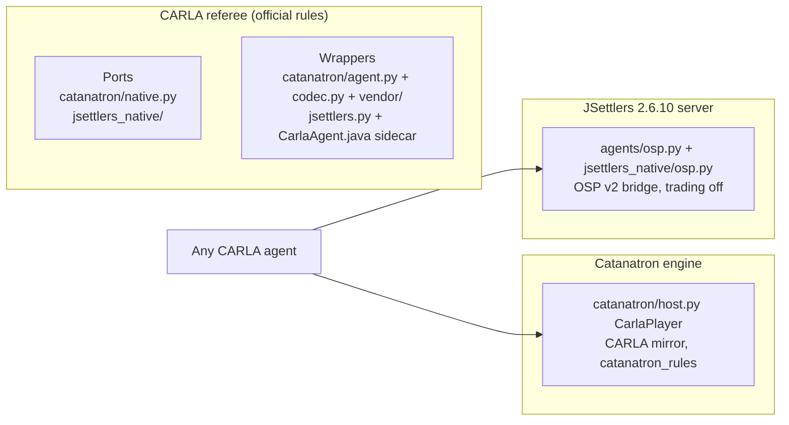

# Maintaining the benchmark bots

For people changing the ports, wrappers or bridges. Usage is in [README.md](README.md); how
the ports were built is recorded in [archive/](archive/).

## How the pieces fit

| Pinned upstream | Where |
| --- | --- |
| Catanatron `ecf931181b9a65bb4116a2153fb78c16f1438e00` | `scripts/setup_benchmarks.py`, `pyproject.toml` (`benchmarks` extra) |
| JSettlers 2.6.10 full JAR, SHA-256 checked (port derived from source commit `c5141056`) | `scripts/setup_benchmarks.py` |

## Deliberate quirks: do not "fix"

The ports reproduce upstream behaviour, bugs included. Changing any of these changes the bot.

**Catanatron upstream mode** (`chance="upstream"`, `native.py`):
- F scores each move on one outcome drawn from Catanatron's RNG (two `randint(1, 6)` dice;
  `choice` over the victim's wood-brick-sheep-wheat-ore cards), and dev-card buys take the
  top of the deck.
- AB2's roll branches roll random dice but are weighted by the intended sum. Steals are 1/5
  per resource type, and an impossible type leaves the position unchanged. Every dev branch
  pops the top card. Spectra are expanded for all moves before searching, which fixes the RNG
  draw order.
- Alpha-beta passes the same bounds into chance children, and search is terminal at any
  player's 10 actual VP.
- Dice probabilities are built by adding 1/36 per pair, `proba_point = 2.778 / 100`, and terms
  are summed in `base_fn`'s order.

**`EngineConfig.catanatron_rules`** (`engine/rules.py`): shortages pay nobody; discards go in
seat order from seat 0; road trails never enter an opponent's corner, and lengths are running
maxima; Longest Road after a split goes to the longest road with no 5-road minimum. Keep it
off by default and out of `to_dict` when False.

**JSettlers port** (`jsettlers_native/`):
- float32 arithmetic and rounded dice probabilities (`planning/jsettlers_eta.py`), and a
  descending discard order.
- Tracker award ETAs are cached (500, 20 roads, 500) and refreshed only by `win_times`
  (`updateWinGameETAs`). The robber uses `projected_win_times`, and dev-card scoring leaves
  the VP-card caches.
- Candidate graphs: prerequisite lists keep insertion order (`_insertion_order`, Java edge
  adjacency order), counts stay stale until a prerequisite is removed (`_incremental_count`),
  hypothetical pieces update road lengths, and good roads use SHIP's ETA.
- Turn flow: a Largest Army knight is played before planning, `done_trading` lasts until the
  turn ends, and turn resets run on `TURN_ENDED`.
- Negotiation: selling flags reset from holdings at turn ends and after our own production
  (never on single gains); `wants_another` survives turns; `considerOffer2` checks the
  receiver's cards, then its target, then the sender's; counters only on `COUNTER`; threats
  match by type and location.
- An initial road with no scored destination uses destination coordinate 0.

## Before merging a change

1. `python scripts/setup_benchmarks.py --skip-catanatron` if `adapters/jsettlers/` changed.
2. `python -m pytest tests/agents -q`, with the JSettlers environment set so the Java tests
   run (slow tests included).
3. JSettlers corpus: `check_jsettlers_policy.py --compatibility java-adapter --seats 0 1 2 3
   --max-decisions 400`, with and without `--trading`, for seeds 12, 31, 47, 58, 101, 202, 303
   and 404. Expect no divergence except seed 202, seat 2 (FAST).
4. Catanatron corpus: `check_catanatron_policy.py compare --bots f ab2 --seeds 12 31 47 58
   --information open --chance upstream`. Expect F 100% and AB2 at least 99.8%.
5. After behavioural changes, rerun `run_strength_parity.py` and update
   `results/policy_corpus.json` and the tables in [README.md](README.md).

## Finding a divergence

Agreement fails at the first differing *move*, but the cause is usually the first differing
*internal value*, many steps earlier.

1. Replay the corpus history to the divergence (both agents see the same events).
2. JSettlers: compare internal state with the Java sidecar's `inspect` operations:
   `snapshot` (win, road and army ETAs, candidates with prerequisites, negotiation targets,
   selling and wants-another flags, the `plans` counter), `win_times`, `try_road` and
   `consider`.
3. Walk the history and stop at the first step where that value splits. Then find every place
   the Java code updates it (for example `grep updateWinGameETAs`). Most bugs were a value
   updated at a different moment, not computed differently.
4. Catanatron: compare per-move root values at full precision (`repr`). At around 1e15,
   arithmetic order flips ties. Upstream's `alphabeta` on `expand_spectrum` gives its root
   values.
5. Add the formerly diverging history to
   `test_java_adapter_compatibility_decision_sequences` or the Catanatron host tests.

## Known gaps

- JSettlers seed 202, seat 2: two equal-length road paths ordered by Java's setup-time graph
  expansion. Fixing it means porting `SOCPlayerTracker`'s incremental updates from the first
  placement.
- AB2 upstream: inner-node road and maritime order (networkx and set iteration) is not
  reproduced.
- Catanatron mirror: road lengths and the Longest Road holder are adopted from Catanatron
  where its component bookkeeping differs (counted in `CarlaPlayer.road_resyncs`).
- JSettlers server: trading off; hidden-world search agents unsupported; opponents' discard
  types are hidden from a PPO belief.
- Training opponents must run in process; the Java wrappers can only be evaluated against.
- `PYTHONHASHSEED` must be fixed for Catanatron code. The scripts re-run themselves, and
  `CatanatronAgent` warns otherwise.
